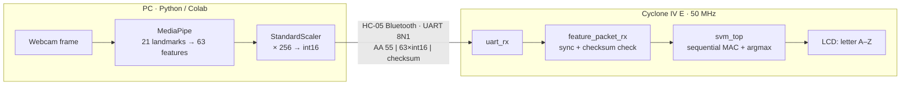

# FPGA-Based Sign Language Recognition

> Recognising the 26 ASL alphabet letters with MediaPipe hand landmarks and a fixed-point linear SVM implemented in VHDL on an Intel Cyclone IV E FPGA (Terasic DE2-115).


## Overview

The software side (Python, Google Colab):
- MediaPipe turns a hand image into **21 landmarks × (x, y, z) = 63 features**.
- The features are standardised and classified by a **26-class linear SVM**, which reaches **~97 % test accuracy**.
- The trained weights and the live feature vectors are **quantized to 16-bit fixed point**.

The hardware side (VHDL):
- The quantized feature vector reaches the FPGA over an **HC-05 Bluetooth UART link** as a framed, checksummed packet.
- The FPGA validates the packet and evaluates the SVM with a **single multiply-accumulate (MAC) unit**.
- It shows the winning letter on the board's LCD.

**Why a single MAC unit:** the first hardware design evaluated all 26 classes in parallel. Quartus hit internal errors and crashed during synthesis on that much parallel arithmetic. Reusing **one 16×16 multiplier for all 26 × 63 = 1,638 products** made the design synthesise, and it gives exactly the same results.



## Results

| Metric | Value | How it was measured |
|---|---|---|
| SVM test accuracy (software, float) | 97.27 % (notebook run) / 97.52 % (report run) | Stratified 80/20 split, 8,066 MediaPipe samples, 26 classes |
| Weakest classes | M and N (F1 ≈ 0.85 – 0.87) | Very similar finger positions in static landmarks |
| Hardware vs. software agreement | **26 / 26** test vectors | `tb_svm_top`: predicted class compared with a bit-exact reference model (1 real sample + 25 random vectors) |
| Classification latency | **1,692 clock cycles ≈ 33.8 µs @ 50 MHz** | `tb_svm_top`: cycles from `start` to `done` (simulation) |
| Packet validation | valid packet accepted, bad checksum dropped, receiver recovers | `tb_feature_packet_rx` |

The confusion matrix and the per-class report are in [`training/`](training/README.md).

## Repository structure

```
.
├── rtl/
│   ├── de2_svm_top.vhd          board top level: UART → packet RX → SVM → LCD
│   ├── uart_rx.vhd              UART receiver (8N1, BAUD_RATE generic, default 1 Mbaud)
│   ├── feature_packet_rx.vhd    0xAA 0x55 framing, 63 × int16, checksum check
│   ├── svm_top.vhd              sequential MAC classifier FSM + argmax
│   ├── svm_pkg.vhd              constants + quantized SVM weights and biases
│   └── lcd_letter_display.vhd   HD44780 16×2 LCD controller
├── tb/                          testbenches (svm_top and feature_packet_rx are self-checking)
├── sim/                         run_sim.sh (GHDL) and run_sim.do (ModelSim)
├── training/                    Colab notebook: dataset, MediaPipe, SVM, quantization, testbench generation
└── docs/PROTOCOL.md             packet format, fixed-point scaling, status LEDs
```

## Run the simulation (no hardware needed)

You need [GHDL](https://github.com/ghdl/ghdl) (`brew install ghdl` or `sudo apt install ghdl`), or ModelSim/Questa.

```bash
git clone https://github.com/yasminemagdy/fpga-sign-language-recognition.git
cd fpga-sign-language-recognition
./sim/run_sim.sh            # GHDL, VHDL-2008: compiles and runs all four testbenches
```

The expected output includes:

```
latency: 1692 clock cycles from start to done
tb_svm_top: 26/26 cases matched the reference model
tb_feature_packet_rx: valid packet accepted, all 63 features decoded correctly
tb_feature_packet_rx: bad-checksum packet dropped
tb_feature_packet_rx: receiver recovered, next good packet accepted
```

## Hardware

- **Board:** Terasic DE2-115, Intel Cyclone IV E (EP4CE115F29C7), 50 MHz clock
- **Link:** HC-05 Bluetooth module on a GPIO pin (`HC05_RX`). The module's baud rate must match `BAUD_RATE` in `uart_rx.vhd`.
- **Display:** the on-board 16×2 HD44780 LCD. `LEDR[4:0]` show packet-receiver status, and `KEY[0]` resets the design.
- **Toolchain:** Quartus Prime (top-level entity `de2_svm_top`). The Quartus project files are not included in this repository.

## My contributions (team project, CEN466 Advanced Digital Systems Design)

- Built the **machine-learning pipeline**: dataset preparation, MediaPipe landmark extraction, feature scaling, and **training and evaluating the linear SVM**, including confusion-matrix analysis of the M/N confusion.
- Designed and implemented the **fixed-point quantization** of features and SVM parameters, and checked that quantized vectors give the same predictions as the floating-point model.
- Wrote the **Colab flow that captures a live frame and generates a VHDL testbench** from it, so the hardware classifier can be checked against the Python prediction.
- Got the **HC-05 Bluetooth link** working (pairing and configuration) for sending vectors to the board.
- Helped **debug the Quartus synthesis crashes**:
  - Ruled out the LCD module and the tool version.
  - Traced the problem to the parallel arithmetic.
  - Helped restructure the design around a sequential MAC unit.

Hardware testing on the board was carried out with my teammate Hala.

## Limitations and future work

- Static-image classifier: the dataset's J and Z images are single frames, although the real signs involve motion.
- Feature extraction runs on the PC. Moving the landmark normalisation onto the FPGA, or adding a small CNN accelerator, would remove the PC from the loop.
- The accumulator is 64 bits wide but only about 40 bits are needed, so it could be narrowed to save logic.
- Add a Quartus resource-utilisation report and timing results.

## License

[MIT](LICENSE)
