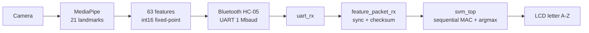
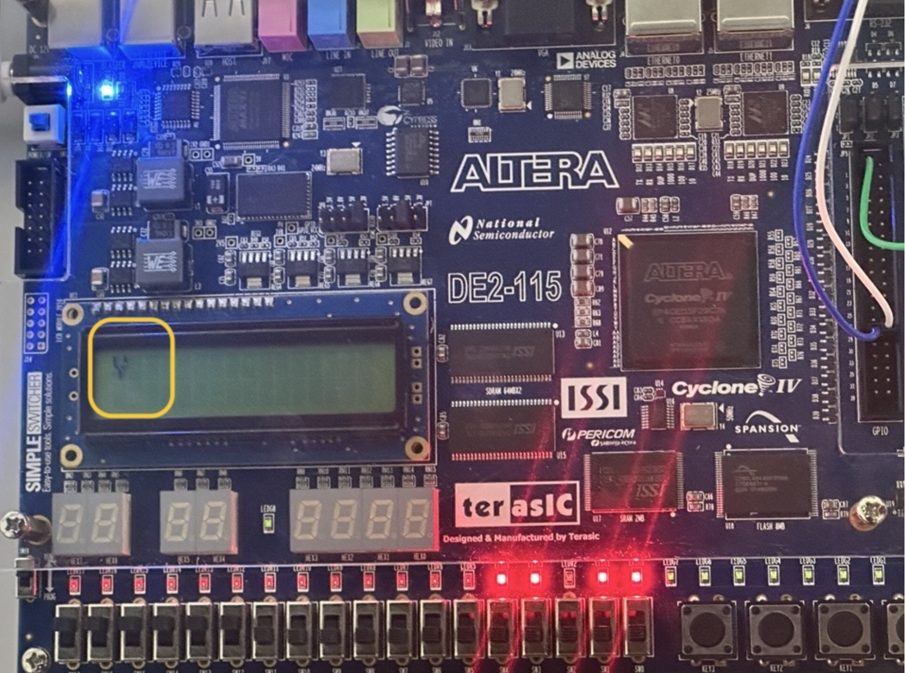

# 🤟 FPGA-Based Real-Time Sign Language Recognition

> Recognizing all 26 ASL alphabet letters in real time with MediaPipe hand landmarks and a sequential-MAC SVM classifier running on a Cyclone IV FPGA.


Course project for **CEN466 / EEN466 – Advanced Digital System Design** (Abu Dhabi University, Spring 2025–26).

## Description

A PC extracts **21 3D hand landmarks** (63 values) from a camera feed with MediaPipe, converts them into a **fixed-point feature vector**, and streams it over **Bluetooth (UART)** to a Cyclone IV FPGA. The FPGA validates the packet, classifies the gesture with a **26-class linear SVM** implemented in VHDL, and shows the recognized letter (A–Z) on the board's LCD.

The first design used 26 parallel classifiers. Replacing them with a **single sequential Multiply-Accumulate (MAC) engine** cut resource usage substantially while keeping the same classification result.



## Key Features

- Recognizes **all 26 ASL alphabet letters**
- **63 geometric features** from 21 MediaPipe 3D landmarks, sent as signed 16-bit fixed-point values
- **Bluetooth-UART interface** (8N1, 1 Mbaud) with a framed packet: `0xAA 0x55` header, 126 data bytes, 8-bit checksum
- **Packet validation in hardware**: bad checksums are dropped
- **Sequential MAC classifier**: one 16×16 multiplier reused for all 26 × 63 = 1,638 multiply-accumulates, followed by argmax
- Inference latency of about **1,690 clock cycles (≈ 34 µs at 50 MHz)**, measured in simulation
- Status LEDs for packet debugging and an HD44780 LCD for the recognized letter
- Full VHDL testbench set (UART, packet receiver, SVM, and full system)

## Screenshot / Demo




## Repository Structure

```
.
├── rtl/
│   ├── de2_svm_top.vhd          # board top level (UART → packet RX → SVM → LCD)
│   ├── uart_rx.vhd              # UART receiver (1 Mbaud, 8N1)
│   ├── feature_packet_rx.vhd    # 0xAA 0x55 framing, 63 × int16, checksum
│   ├── svm_top.vhd              # sequential MAC classifier FSM
│   ├── svm_pkg.vhd              # constants + model weights / biases
│   └── lcd_letter_display.vhd   # HD44780 LCD controller
├── tb/                          # testbenches for each module + full system
├── sim/                         # run_sim.sh (GHDL) and run_sim.do (ModelSim)
├── docs/PROTOCOL.md             # packet format and fixed-point notes
├── host/                        # PC-side Python (MediaPipe → Bluetooth)
├── training/                    # model training and weight export
└── quartus/                     # Quartus project and pin assignments
```

## Install & Run (≈5 minutes)

### 1. Simulate (no hardware needed)

Requires [GHDL](https://github.com/ghdl/ghdl) (`brew install ghdl` on macOS, `sudo apt install ghdl` on Ubuntu) or ModelSim/Questa.

```bash
git clone https://github.com/YOUR_USERNAME/fpga-sign-language-recognition.git
cd fpga-sign-language-recognition

./sim/run_sim.sh                  # GHDL: runs all four testbenches
# or, with ModelSim:
vsim -do sim/run_sim.do
```

Expected: each testbench ends with `simulation stopped`. Waveforms are written to `sim/work/*.ghw` (view with GTKWave).

### 2. Build and program the FPGA

1. Open the Quartus project in `quartus/` (Quartus Prime Lite with Cyclone IV support).
2. Set the top-level entity to `de2_svm_top`.
3. Compile, then program the board with the generated `.sof` through the USB-Blaster.
4. Connect the Bluetooth module's TX to the `HC05_RX` pin. Configure it for **1,000,000 baud**.

### 3. Run the PC side

```bash
cd host
pip install -r requirements.txt
python hand_to_fpga.py --port <your-bluetooth-serial-port>
```

Show an ASL letter to the camera and the letter appears on the LCD. `KEY[0]` resets the design.

## Hardware Used

- **FPGA board:** Terasic DE2-series, Cyclone IV E *(confirm exact model)*, 50 MHz clock
- **Bluetooth module:** HC-05 (UART, 1 Mbaud)
- **Display:** 16×2 character LCD (HD44780-style, on the board)
- **Camera:** PC webcam

## Tech Stack

- **Hardware description:** VHDL-2008
- **FPGA toolchain:** Intel Quartus Prime, Cyclone IV E
- **Simulation:** GHDL, ModelSim
- **Host software:** Python, MediaPipe Hands, OpenCV, PySerial
- **Machine learning:** linear SVM (one-vs-rest), 16-bit fixed-point weights
- **Interfaces:** UART over Bluetooth (HC-05), HD44780 LCD

## How It Works

1. **Features:** the host builds 63 values from the 21 landmarks (x, y, z) and scales them to `int16`.
2. **Packet:** `AA 55 | 63 × int16 (little-endian) | checksum` is sent over UART ([details](docs/PROTOCOL.md)).
3. **Receive:** `uart_rx` deserializes bytes and `feature_packet_rx` assembles the vector and checks the checksum.
4. **Classify:** `svm_top` loops over 26 classes. For each class it accumulates `bias + Σ x[i]·w[class][i]` (63 steps) and keeps the best score.
5. **Display:** the winning index is converted to ASCII (`'A' + index`) and written to the LCD.

## Limitations & Future Work

- The testbenches stimulate the design but do not yet include self-checking assertions.
- Accuracy depends on lighting, hand pose, and camera angle, since MediaPipe runs on the PC.
- Planned: narrower accumulator, on-FPGA feature extraction, and a larger gesture vocabulary (words/dynamic signs).

## License

[MIT](LICENSE)
