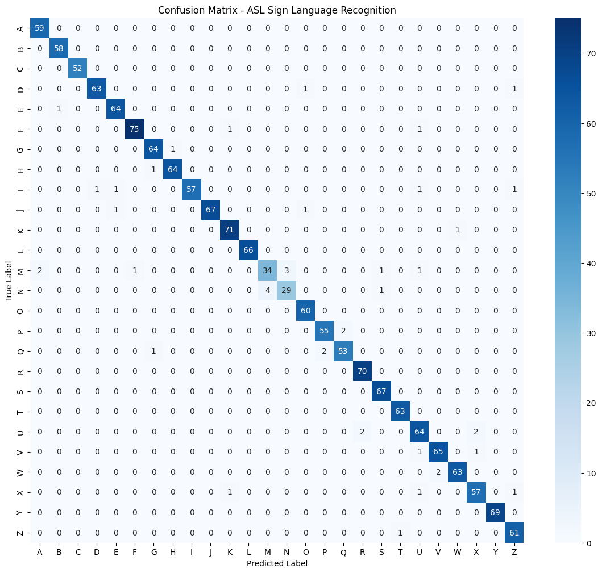

# Model training and quantization

`asl_svm_training_quantization.ipynb` is a Google Colab notebook. It covers the whole software side of the project:

1. **Dataset:** the Kaggle [ASL Alphabet](https://www.kaggle.com/datasets/grassknoted/asl-alphabet) dataset (`grassknoted/asl-alphabet`), letters A–Z. The notebook takes 400 images per letter.
2. **Feature extraction:** MediaPipe Hand Landmarker gives 21 landmarks with (x, y, z) each, so 63 features per image.
   - Images where no hand is detected are skipped. That left **8,066 usable samples**; 2,334 images failed detection.
   - M and N have the fewest usable samples (211 and 172).
3. **Training:**
   - `StandardScaler` on the features.
   - A stratified 80/20 train/test split.
   - `LinearSVC` (C = 1.0), one-vs-rest, which gives 26 weight vectors and 26 biases.
4. **Evaluation:** accuracy, a per-class report and a confusion matrix.
   - Test accuracy is **97.27 %** in the saved notebook run and 97.52 % in the run reported in the project report (1,614 test samples).
   - M and N are the most confused pair.
5. **Quantization for the FPGA:**
   - Weights: `round(W × 256)` → `int16`.
   - Biases: `round(b × 256²)` → `int32`, so they match the scale of the feature × weight products.
   - Live features: `round(standardised feature × 256)` → `int16`.
6. **Hardware/software check:** one webcam frame is captured in Colab, classified in Python, and quantized. A VHDL testbench (`tb_svm_top.vhd`) is generated with that vector so the FPGA classifier can be checked against the Python prediction.
   - The first test vector in `tb/tb_svm_top.vhd` comes from this flow.

